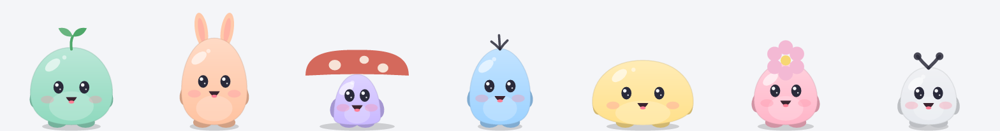
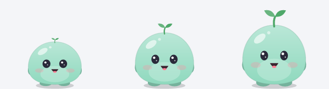
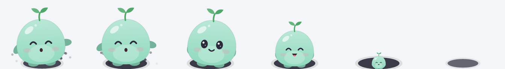
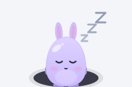

# Pip — a tiny companion that lives on your computer

**Pip is a small creature that sits on your Windows desktop and quietly reminds you about the
things humans forget: water, stand-ups, vitamins, calling someone back. It is built to be barely
noticeable as software — one process, a few megabytes of memory, and nothing happening at all
when nothing needs to happen.**



*Seven companions, seven colours. Every one of them is drawn by code — there are no image files in
this program, which is why it is two megabytes and crisp on any screen.*

Measured on the machine it was written on. The right-hand column is the one that matters: the
installed build, mail, calendar and phone sync all connected, twelve hours into a working day.

| | Fresh start, nothing connected | In use, 12 h, all sync on |
|---|---|---|
| Memory, as Task Manager shows it | 1.4 MB | 3.1 MB |
| Memory, committed (private bytes) | 2.0 MB | 5.5 MB |
| CPU | — | 0.8 s per hour, lifetime average |
| Threads | 3 | 3 idle, up to 9 mid-sync |
| Handles | 154 | 338–418 |
| Startup | 17–44 ms cold, over 8 logged launches | |
| Download | one 2.1 MB `pip.exe`, no installer, no runtime, no dependencies | |

Sampled for four hours at five-minute intervals (49 readings): private bytes wandered between 4.7
and 6.0 MB and handles between 338 and 418, each drifting up and then back down again. Churn, not
a leak. Earlier versions of this table quoted the fresh-start figures as though they were the
connected ones; they were not, and §53 of the design document says so.

There is no account, no server, and no telemetry. Nothing leaves your machine until you connect a
service, and then only to Google, as you — see [What leaves your machine](#layout) below.

### The design document is the interesting part

[**docs/DESIGN.md**](docs/DESIGN.md) is 59 sections of *why*, written as the thing was built. It is
not a feature list: it is the reasoning, including the parts that did not work.

- Why Rust and a hand-drawn Win32 window instead of Electron or Tauri, with the RAM numbers that
  decided it (§3)
- What was deliberately **not** built, and the argument in each case: guilt-tripping, refused four
  separate times; an iOS app, dropped over a recurring fee rather than anything technical; two
  pieces of cryptographic hardening, declined because the attack needs someone already inside your
  Google account; a screen reader, named as its own milestone rather than half-built (§28, §33,
  §44, §45, §46)
- A full security review of the token storage, the sync key and the encrypted document, and what a
  stolen state file actually reveals (§37)
- **The day a permissions fix destroyed a real person's settings** — what the bug was, how it was
  recovered, and the deeper defect it exposed: a file that cannot be read is not a file that is not
  there (§38, §39)
- Experiments that were tried, rendered, and thrown away for being invisible at the size they are
  drawn (§40, §41, §42)

Where a decision was later reversed, the original section says so rather than being quietly
corrected.

## Installing

Double-click `pip.exe` and choose **Yes** when it offers to install. Pip copies itself to
`%LOCALAPPDATA%\Programs\Pip`, adds a Start-menu entry, starts with Windows and appears in
**Apps & features** like any other program — all per-user, so no administrator rights and no UAC
prompt. Choose **No** to run it from where it is (portable). Settings › About has the same
**Install** button, and **Remove Pip** when it is installed.

**Windows will warn you first.** Pip is not code-signed — a certificate costs a few hundred a year
and this is a free pet — so SmartScreen shows *"Windows protected your PC"* the first time you run
it. Click **More info**, then **Run anyway**. You only see it once. It is not a judgement about the
file; it is what Windows says about anything it has not seen signed before.

## Using it

- **Drag** the pet anywhere; it remembers the spot and snaps onto the taskbar edge.
- **Hover** to see the time. **Click** for today's card (time, date, water, next reminder).
- **Double-click** to log a glass of water.
- **Right-click** (pet or tray icon) for: log water / undo, Do not disturb, Always on top, Settings, Quit.
- **Tray icon** click shows/hides the pet. When hidden, reminders arrive as Windows notifications —
  and the pet digs itself a hole and climbs in rather than simply vanishing.
- Reminders appear as a speech bubble: **Done / Snooze / Dismiss**. Ignored bubbles fold into a
  small badge on the pet after a few minutes; click the pet to bring it back.

**Your companion.** Settings › Companion picks who it is. Four are there from the first day —
**Sprout**, **Bunny**, **Toadstool** and **Tuft** — and they are yours forever; changing your mind
costs nothing and nothing is ever taken away. Name it, colour it, size it, give it a voice.

**Growing up.** A companion grows over three stages as it earns *good days*: one per day, for
meeting your water goal **or** for any moment together — a pat, a reminder finished, a glass
logged. Either counts, so it still grows with water reminders switched off. It reaches the second
stage at 15 good days and is fully grown at 45. The count never goes down, a quiet day is never
mentioned, and time away costs nothing: a fortnight with the computer off leaves it exactly where
it was. There is no streak to break here.



*Newly arrived, growing up, grown. Size is the least of it — the eyes shrink relative to the face
and the sprout comes in, because "drawn slightly smaller" is not something anybody reads as young.*

**Three more arrive.** **Pebble**, **Bloom** and **Moth** turn up at 7, 21 and 45 good days. They
are gifts rather than unlocks: nothing counts down to them, nothing is shown greyed out, and the
only thing that happens is that one day your companion mentions a visitor. If you never look at the
settings, nothing nags you about it.

**It has a life of its own.** Left alone it looks around, stretches, scratches, sniffs at something,
occasionally sneezes, wanders a little way off and thinks better of it, or trips over nothing and
picks itself up — and it sits perfectly still about a third of the time, which matters more than
any of the rest. Hiding it is a dig rather than a disappearance:



During quiet hours it sleeps in that burrow instead of beside it, breathing, turning over, and once
in a while having a bad dream it recovers from — then stretches and climbs out in the morning.



**Keyboard.** The settings window works without a mouse: **Tab** and **Shift+Tab** move through
everything including the page list, **Enter** or **Space** activates, **←/→** move within a row of
choices, and **Esc** closes (or leaves a text field first). A screen reader cannot see the window
yet — see §45 of the design document.

**Dates & calendars.** Add birthdays, anniversaries and deadlines in Settings › Calendar (with an optional
heads-up a few days before). South African public holidays are built in. Calendars come from Google
(Settings › Connections): events show on today’s card, important ones (own alert, important calendar
or a keyword like “dentist”) get a gentle alert, and a quiet morning summary lists what’s on.

**Connections.** Settings › Connections has three entries, and they all work the same way: click *Continue
with Google*, choose your account, Allow, and you’re back in Pip, connected. **Gmail** gives Pip the
sender, subject and labels of new mail — never the contents — and it can’t send or delete. **Google
Calendar** is read-only. Disconnect (asks once more) also withdraws Pip’s access at Google; if Google
ever signs Pip out, the entry shows **Reconnect**. Important senders and subject words live in
Settings › Email, along with two one-tap rules: mail Gmail marks Important, and mail that is already
starred when it arrives. When Pip nudges you about a single email, the bubble offers **Always from
this sender** — one click and that address always gets through.

**Reminders.** A reminder has a name, one or more times of day, and the days it repeats — so
"take pills" at 08:00, 14:00 and 20:00 is one reminder, not three. On the phone they behave like the
phone’s own alarm: exact, out of Doze, and over the lock screen with Snooze and Done. While you are
using the phone the same two buttons arrive as a notification instead of taking the screen. You can
add and edit reminders on either device.

**Your other devices.** Sync keeps reminders, dates, water history and preferences the same on every
device, through one encrypted file in your own Google Drive app folder — Pip has no server. Sign in
with the same Google account on the next device and it asks to join; this one shows *“… wants to
sync — Approve”*. One tap, nothing to type, and the key is sealed so only that device can open it.

The pet naps during quiet hours, when you're away (5 min without input) and while the PC is locked,
and holds reminders during fullscreen games, videos and presentations.

## Building

Requires Rust (stable) and the MSVC build tools.

```bash
cargo test -p pip-core              # core logic tests
cargo build --release               # target/release/pip.exe (~2.1 MB, no dependencies)
cargo build --features devtools     # dev build with the automation/snapshot command channel

# Regenerates every picture in this file from the drawing code itself
cargo run -p pip-draw --example shots --features png-format
```

The pictures above are generated rather than captured, which is the only reason to trust them: a
screenshot is a claim about what the program looks like, and a claim kept by hand is one this
project has had to correct four times in a fortnight (§51). These come out of the same
`creature::draw` the desktop and the phone call, so a picture that is wrong means the program is
wrong.

Run tools against a throw-away profile by setting `PIP_DATA_DIR`; the app then never touches your
real settings or the Windows startup entry.

**Google sign-in identity.** One-click "Connect Gmail" needs Pip's own OAuth client (type *Desktop
app*) from a Google Cloud project with the Gmail API enabled and the consent screen published.
Download its JSON from the Google Cloud console and save it as `app-windows/google-client.json`
(git-ignored) before building; `build.rs` compiles it in. For installed apps Google treats this as an
app identifier, not a secret. This is a one-time developer step: users never see it. Without it, Pip still builds
but can’t connect Google accounts (release builds print a warning). `node tools/mock-google.js` + a devtools build test the whole flow offline.

```bash
powershell -ExecutionPolicy Bypass -File tools/measure.ps1 -Minutes 10   # resource targets
```

## The phone app

`app-android/` is Pip on Android: the same Rust brain (`app-android/rust`, a small JNI bridge over
`pip-core`) behind a Compose screen. Sign in with the same Google account as the PC, tap Approve on
the PC when it asks, and the same reminders appear.

**Your companion is there too, and it is the same companion.** Not a copy of the artwork and not a
second drawing — the phone calls the identical Rust the desktop draws with (`pip-draw`), which
renders the creature into a buffer that Compose shows as a bitmap. Character, colour and growth
stage all follow the PC: pick a Toadstool in lavender there and that is what the phone shows, and a
character that has not arrived yet (see *Three more arrive* above) is not drawn on the phone either.

It renders once when something changes rather than on a timer. A pet repainting itself sixty times
a second inside a list view is a battery decision, not a drawing one, so there is no animation on
the phone — see §50 of the design document for that argument.

Building it needs a JDK 17, the Android SDK (platform 34, build-tools 34, NDK 26) and `cargo-ndk`:

```bash
rustup target add aarch64-linux-android
cargo install cargo-ndk
cd app-android && ./gradlew assembleDebug        # app/build/outputs/apk/debug/app-debug.apk
```

Gradle runs `cargo ndk` first, so the `.so` in `jniLibs` is always built from the Rust you have —
nothing binary is checked in. `local.properties` points at the SDK; `ANDROID_NDK_HOME` must point at
the NDK.

**Google sign-in identity.** Like the desktop, the phone needs Pip's own OAuth client — type
*Android*, with the package name `com.pip.companion` and the signing certificate's SHA-1. Save the
client id as `app-android/google-client-android.json` (git-ignored); the build compiles it in.
Android clients carry no secret: Google checks the app's signature instead.

## Layout

```
core/          pip-core: settings, reminder engine, quiet hours/DND policy, mood, copy (no OS code)
app-windows/   Windows shell: layered pet window, renderer, tray, settings window, persistence
app-android/   Android shell: Compose screen, Google sign-in, sync; rust/ is the JNI bridge to pip-core
docs/          design document
tools/         measurement script, mock Google server for sign-in tests
```

Data lives in `%APPDATA%\Pip` (`settings.json`, `state.json`, `pip.log`), in a folder Pip locks to
your Windows account on first run.

**What leaves your machine.** Nothing, until you connect a service — Pip has no account of its own,
no server behind it, and no telemetry of any kind. Connect something and it talks to Google only,
signed in as you: **Gmail** metadata only, meaning sender, subject and labels and never the contents
of a message (the permission Pip asks for cannot return a message body, so this is enforced by
Google rather than promised by us); **Google Calendar** read-only; and **sync**, which puts one
encrypted file in your own Google Drive that only your devices can read. Disconnecting withdraws
Pip's access at Google's end too.

The crash log stays on your machine. Nothing is ever uploaded, and there is nothing to upload it to.

## Licence

MIT — see [LICENSE](LICENSE). Do what you like with it.

The one thing you cannot reuse is Pip's Google sign-in identity: `google-client.json` and
`google-client-android.json` are not in this repository and never have been. Building from source
without them gives you a working Pip that cannot connect Gmail, Calendar or phone sync; everything
else runs. Making your own is a free Google Cloud project and twenty minutes.
